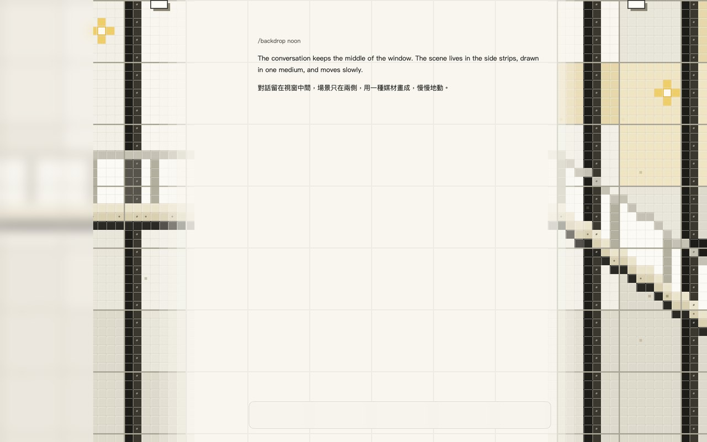
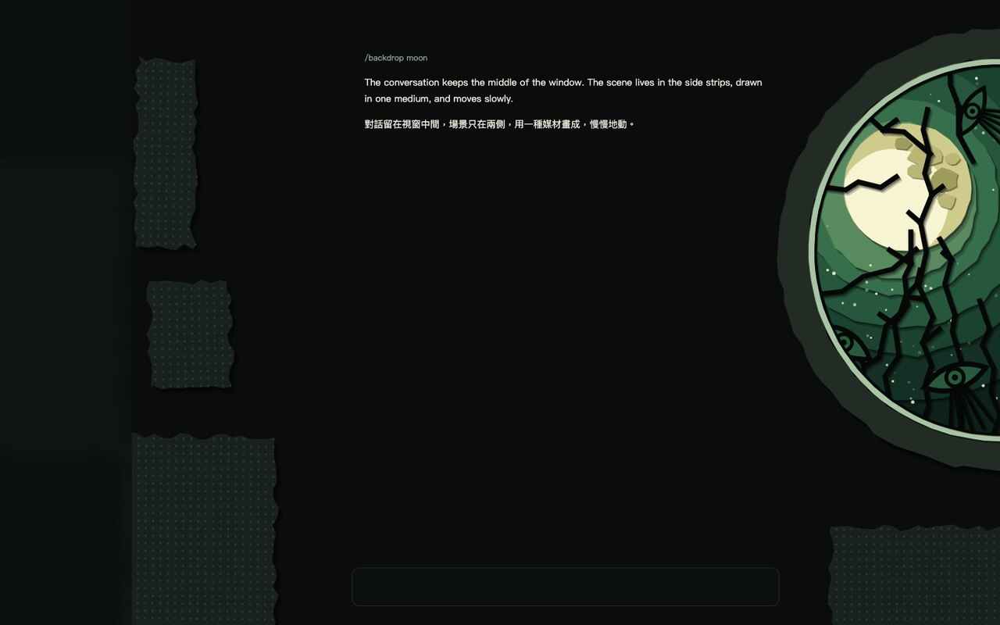
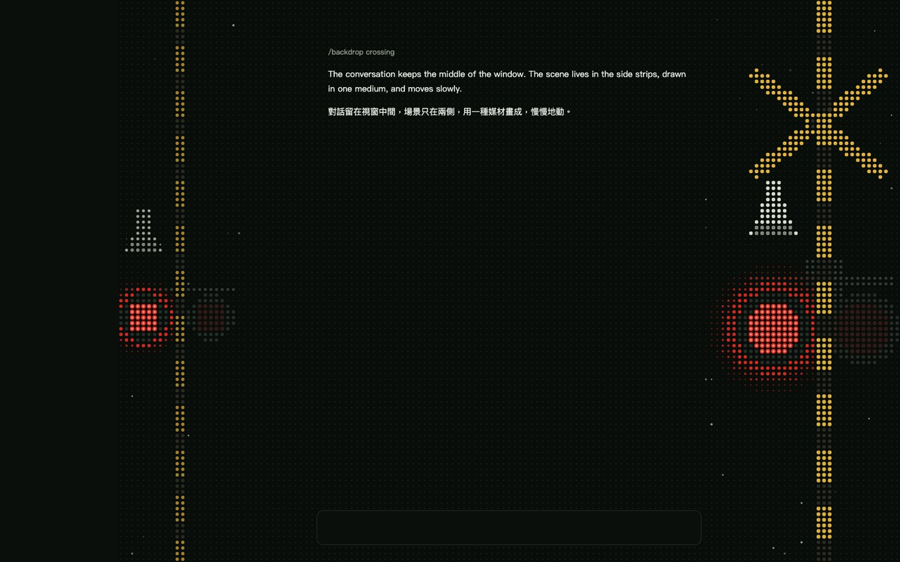

# Desktop Backdrops · Claude 桌面版動態背景

給 Claude 桌面版（Code 分頁）用的動態背景：場景在對話後面慢慢地動，對話欄保持乾淨。附一個 skill，讓 Claude 照一套規則，從你給的參考圖做出新的背景。

Animated backdrops for the Claude desktop app (Code tab): scenes that move slowly behind the conversation and keep its column clear. Comes with a skill that has Claude design new backdrops from your own reference images, by a set of rules.

> 非官方作品，與 Anthropic 無關。Unofficial; not affiliated with or endorsed by Anthropic.

| `/backdrop noon` 白晝中庭 Atrium Noon | `/backdrop moon` 月之圓窗 Moon Window | `/backdrop crossing` 夜之平交道 Night Crossing |
|---|---|---|
|  |  |  |

[中文](#中文) · [English](#english)

---

## 中文

### 這是什麼

一個 Claude Code plugin，裡面有三樣東西：

1. **三個做好的動態背景**，方塊、剪紙、點陣各一
   - **白晝中庭**（淺色，方塊）：過曝的玻璃中庭。走道中段被正午的光吃掉，左邊留一段走道，右邊是往下的樓梯。金色光帶掃過窗格、玻璃反光、紙片一格一格翻落。
   - **月之圓窗**（深色，剪紙）：右側的大圓窗、綠色夜空與滿月、裂紋般的鐵窗花和會眨眼的眼睛。光暈的紙層緩慢縮放、星星閃爍、紙片輕擺。
   - **夜之平交道**（深色，點陣）：像 LED 看板一樣用點畫成的夜間平交道，兩側各一根黃黑柱子，對話欄正好是中間的路。紅燈左右交替閃、警鈴響起時有一圈圈的點擴散、星星閃爍。
2. **`/backdrop` 指令**：切換、關閉背景，會記住你上次的選擇，之後新開的對話自動套用。
3. **`new-backdrop` skill**：給 Claude 一張參考圖，說「做一個新的背景」，它會照 [`RULES.md`](RULES.md) 的五條規則，從方塊、剪紙、點陣、色塊四種媒材挑一種設計新場景，並用附的預覽工具檢查。需要像原圖的人物時，可以把圖描成色塊（`tools/trace.py`）。

### 需要什麼

- **Claude 桌面版**的 Code 分頁，而且要是支援背景主題的較新版本。終端機和 VS Code 不會畫背景。
- 不需要另外安裝 Anthropic 的 `theme-examples` 或其他 plugin，裝這一個就能用。
- 想自己做新背景的話，還需要 Node.js 和 Google Chrome（給預覽工具用）。

### 安裝

**在桌面版：** 點輸入框旁的 **+** → **Plugins** → **Add marketplace**，輸入 `leifshen/claude-desktop-backdrops`，再把 **desktop-backdrops** 加進來。

**在終端機：**

```
/plugin install desktop-backdrops --marketplace leifshen/claude-desktop-backdrops
```

出現「Add marketplace?」時按 `y`，範圍選 user。

### 使用

| 指令 | 作用 |
|---|---|
| `/backdrop list` | 列出所有背景，▶ 是目前使用中的 |
| `/backdrop noon` | 白晝中庭（淺色視窗） |
| `/backdrop moon` | 月之圓窗（深色視窗） |
| `/backdrop crossing` | 夜之平交道（深色視窗） |
| `/backdrop off` | 關閉背景 |

套用後視窗會自動切到該背景對應的淺色或深色。

### 自己做新背景

從 GitHub 安裝的版本是唯讀副本，要做新背景，先下載一份到你自己的資料夾，改從那裡安裝：

```bash
git clone https://github.com/leifshen/claude-desktop-backdrops.git ~/claude-desktop-backdrops
claude plugin uninstall desktop-backdrops
claude plugin marketplace add ~/claude-desktop-backdrops
claude plugin install desktop-backdrops@leifshen
```

接著在桌面版開一個對話，附上參考圖，說「做一個新的背景主題」。Claude 會先列出圖裡認得出來的元素、說明要用哪種媒材、哪些東西要搬到兩側，再動手畫。畫好後打 `/reload-plugins`，再打 `/backdrop <新名字>`。

五條規則的重點：

1. **元素不碰對話欄**：畫面寬度 27%–78% 只留底色，主角放右側，配角放左側。
2. **一張只用一種媒材**：方塊、剪紙、點陣、色塊四選一，連光暈都用這種媒材做。做法可以重新畫，或用描圖工具把圖描成色塊。
3. **忠於參考圖**：認得出來的元素逐項保留，只為了避開對話欄而搬動。公開或私人看來源：描別人的作品只能自己用。
4. **動態要慢、要看得見**：淺色場景不用白色做動態。
5. **技術雷**：SVG 不能用 `<filter>`（桌面版會吃掉，整張圖消失）。

### 描圖與私人背景

色塊這種媒材可以用 `tools/trace.py` 把一張圖描成向量色塊，最像原圖，人物也畫得出來。描出來的是向量，所以背景照樣能動。動畫畫面、插畫、海報這類本來就是平塗的圖效果最好；照片會變成色調分離的海報感。

能不能公開，看圖從哪裡來：自己拍的照片、自己畫的圖、可以自由使用的素材，描出來可以分享；別人的作品（例如動畫截圖）描出來只能自己用，不該放上公開的 repository。這類背景放在 plugin 資料夾裡的 `private/`：

- `private/looks.json` 列出私人背景（格式和 `hooks/looks.ts` 的欄位相同，SVG 寫成檔名）。
- 每個背景的 SVG 檔放在 `private/` 底下。
- `private/` 已列在 `.gitignore`，不會被提交。`/backdrop list` 照樣列得出來。

描人物時可以對人物那一塊另外用更高解析度細描（`rois` 設定），讓頭髮、膚色有自己的顏色。

### 常見問題

- **開新對話時沒有背景**：桌面版要等你送出第一則訊息才真正啟動對話，背景會在那之後出現。
- **換了配色卻沒有圖**：場景用了 `<filter>`，或 app 版本太舊。`/backdrop` 的回覆會說視窗有沒有畫出來。
- **背景完全不動**：場景裡嵌入了點陣圖（`<image>`），app 會把整張背景當成靜態圖畫。改用向量。
- **背景被別的主題蓋掉**：Anthropic 的 `/custom-theme` 在某專案套過主題時，每回合會重新套用。先打 `/custom-theme off`。
- **完全不動**：系統開了「減少動態」，場景會刻意停住。

### 靈感與致謝

- 三個場景的靈感來自〈物語〉系列的背景美術。圖是重新繪製的原創場景，沒有使用或描摹原作素材。
- 做法參考 Anthropic 的 `theme-examples` plugin（Apache-2.0）：剪紙的四層畫法、方塊的格子尺寸、點陣的點格與自帶光暈的亮點、對話欄的留白範圍；場景裡的 `hash` 小函式改寫自其範例。
- `hooks/make-colors.js` 來自 Claude Code 內建的 plugin-authoring skill，依其說明原樣附上。

---

## English

### What it is

A Claude Code plugin with three parts:

1. **Three animated backdrops**, one in each medium: tiles, cut paper, dots
   - **Atrium Noon** (light, tiles): an overexposed glass atrium. The middle of the catwalk is burnt out by the noon light; a stretch of it stands on the left and a staircase goes down on the right. A band of gold light crosses the panes, the glass catches the sun, and sheets of paper tumble down a cell at a time.
   - **Moon Window** (dark, cut paper): a great round window at the right edge, a green night sky and a full moon, crack-like iron tracery with blinking eyes. The paper layers of the glow breathe, stars twinkle, torn patches sway.
   - **Night Crossing** (dark, dots): a level crossing at night drawn like an LED board, a striped post on each side, so the conversation sits on the road between them. The red lamps flash in turn, rings of dots spread from the bell as it rings, stars twinkle.
2. **`/backdrop`**: switch or turn off the backdrop. Your last choice carries over to every new session.
3. **The `new-backdrop` skill**: give Claude a reference image and ask for a new backdrop; it designs the scene by the five rules in [`RULES.md`](RULES.md), in one of four media (tiles, cut paper, dots, flat colour), and checks it with the bundled preview tool. For a figure that has to look like the picture, it can trace the picture into flat colour (`tools/trace.py`).

### Requirements

- The **Claude desktop app**, Code tab, in a recent version that draws backdrops. The terminal and VS Code draw none.
- Nothing else: Anthropic's `theme-examples` or any other plugin is not needed.
- To make your own: Node.js and Google Chrome, for the preview tool.

### Install

**In the desktop app:** click **+** next to the prompt box → **Plugins** → **Add marketplace**, enter `leifshen/claude-desktop-backdrops`, then add **desktop-backdrops**.

**In a terminal session:**

```
/plugin install desktop-backdrops --marketplace leifshen/claude-desktop-backdrops
```

Answer `y` to "Add marketplace?" and pick the user scope.

### Use

| Command | Does |
|---|---|
| `/backdrop list` | List the backdrops; ▶ marks the current one |
| `/backdrop noon` | Atrium Noon (light window) |
| `/backdrop moon` | Moon Window (dark window) |
| `/backdrop crossing` | Night Crossing (dark window) |
| `/backdrop off` | Turn the backdrop off |

The window switches to the light or dark mode each backdrop is made for.

### Make your own

An install from GitHub is a read-only copy. To make new backdrops, keep a copy of your own and install from it:

```bash
git clone https://github.com/leifshen/claude-desktop-backdrops.git ~/claude-desktop-backdrops
claude plugin uninstall desktop-backdrops
claude plugin marketplace add ~/claude-desktop-backdrops
claude plugin install desktop-backdrops@leifshen
```

Then, in the desktop app, attach a reference image and ask for a new backdrop. Claude lists what it recognises in the picture, says which medium it will use and what has to move to the sides, then draws. Type `/reload-plugins`, then `/backdrop <new name>`.

The five rules in short:

1. **Keep clear of the conversation**: 27%–78% of the width holds only the ground; the subject goes right, supporting pieces left.
2. **One medium per scene**: tiles, cut paper, dots or flat colour, glow included. Redraw in it, or trace a picture into flat colour.
3. **Stay true to the reference**: keep every recognisable element; move things only to clear the conversation. Public or private depends on the source: a trace of someone else's artwork is for your own use.
4. **Slow, visible motion**: never animate in white on a light scene.
5. **Pitfalls**: no `<filter>` in the SVG (the app drops it and the whole picture with it).

### Tracing and private backdrops

The flat colour medium can trace a picture into vector colour regions with `tools/trace.py`: the closest to the picture, figures included. The result is vector, so the scene still moves. Art that is flat to begin with (animation, illustration, posters) traces best; a photo comes out posterised.

Whether it may be shared depends on where the picture comes from: your own photo or drawing, or material free to use, may be traced and shared; someone else's artwork (an anime frame, say) traced is for your own use and does not belong in a public repository. Keep such backdrops in the plugin folder's `private/`:

- `private/looks.json` lists your private backdrops (the fields of `hooks/looks.ts`, with the SVG given as a file name).
- Each backdrop's SVG file sits under `private/`.
- `private/` is in `.gitignore`, so it is never committed. `/backdrop list` shows them all the same.

For a figure, a finer pass over its area (the `rois` setting) gives hair and skin colours of their own.

### Troubleshooting

- **A new session shows no backdrop**: the desktop app starts the session when you send the first message; the backdrop appears then.
- **Colours change but no picture**: the scene uses `<filter>`, or the app is too old. `/backdrop` says whether the window draws it.
- **Nothing moves at all**: the scene embeds a raster `<image>`; the app then draws the whole backdrop as a still picture. Use vector shapes.
- **Another theme takes over**: Anthropic's `/custom-theme` re-applies its theme every turn in a project where one was chosen. Run `/custom-theme off`.
- **Nothing moves**: your system asks for reduced motion, and the scenes rest on purpose.

### Credits

- All three scenes are inspired by the background art of the *Monogatari* series. They are original scenes, redrawn; no artwork from the series is used or traced.
- Techniques learned from Anthropic's `theme-examples` plugin (Apache-2.0): the four-pass cut-paper drawing, the tile grid, the dot lattice and its haloed lit dots, the clear band for the conversation; the scenes' small `hash` helper is adapted from it.
- `hooks/make-colors.js` comes from Claude Code's built-in plugin-authoring skill and ships unchanged, as it instructs.

## License

MIT © 2026 Leif Shen
